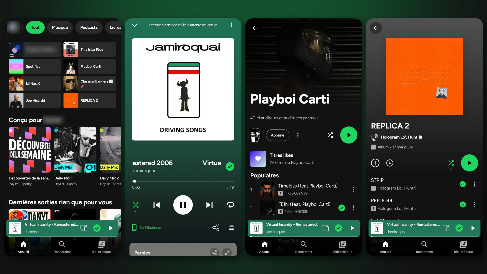
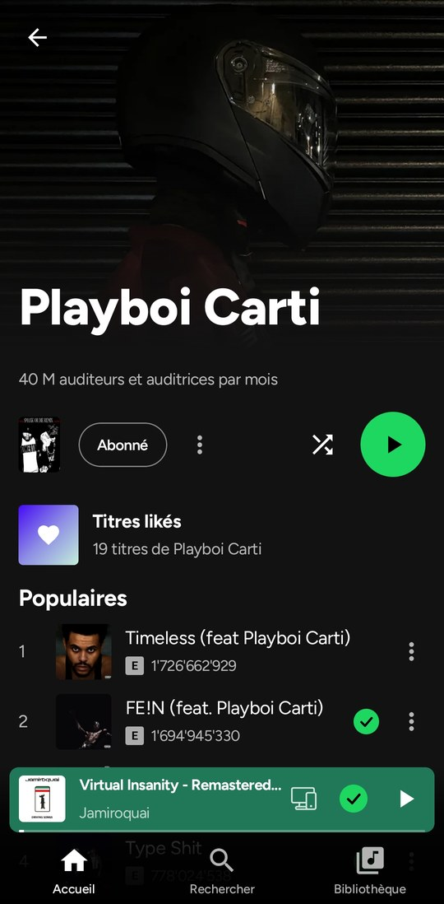

# Myspoti

[](LICENSE)
[](#install)

**Spotify without ads, with downloads, on a free account.** Your own Spotify account, playlists
and Wrapped, in a native Android app that blocks the ads and lets you download your music in
lossless quality.

> **This repository is a personal build of Myspoti.** The app is written by
> [kota-zo](https://github.com/kota-zo/myspoti) and published under GPL-3.0; its source is the
> one here. Builds made here are signed with their own key, are **not** published as GitHub
> releases, and cannot install over an official Myspoti build — uninstall that one first.

<p align="center">
  
</p>

## Why Myspoti

**No ads, on a free account.** No audio ads, no video ads, no banners, and no 30-second break
between songs: Myspoti switches off the ad breaks of Spotify's own player, so a free account
plays like Premium — pick any song, skip as much as you like. No Premium, no modified Spotify
app, nothing to root.

**Download your music, in lossless.** A song, an album, a playlist or all your Liked Songs, to
listen with no connection: on the plane, in the metro, with no data. The audio is better than
Spotify's own — **lossless FLAC** (CD quality, or 24-bit hi-res when it exists), or small AAC
files if you prefer. Each song is the very same recording, found by its ISRC on Tidal or Qobuz
and checked before it is kept (after a one-off verification in Settings). Downloaded playlists
stay in step: songs you add on Spotify download by themselves.

**Everything else you expect from Spotify, and more.** Your home, search, library, playlists,
podcasts, Spotify Connect and Android Auto, plus **word-by-word lyrics**, **official music
videos** and **song meanings from Genius**.

## What is it?

Myspoti is a Spotify app for Android that you install yourself. You sign in with your usual
Spotify account, on Spotify's own login page: Myspoti never sees your password. A free account
is enough.

Under the hood, the official Spotify Web Player plays the music, hidden inside the app, with
your phone's DRM. Myspoti draws its own screens on top and drives it. Your plays are reported to
Spotify exactly as in a browser: they count for the artists, in your history and in your
Wrapped.

## Install

1. Open **Actions → Android → Run workflow**, give the version (e.g. `2.0.2-beta.5`) and let it
   finish, then download `myspoti-<version>` from the run's **Artifacts**. No release and no tag
   is created; the artifact is the APK (kept 14 days).
2. Open the downloaded APK on the phone (Android 10 or later). Android asks once to allow
   installs from your browser or file manager.
3. Tap **Log in with Spotify** and sign in.
4. Pick the sound quality, allow what you want (notifications, Bluetooth, local files…), and you
   are in.

Every build here is signed with the same key, so a newer one installs over the previous one.

## What you get

**Listening**
- No ads (see above).
- Home, search, Browse, New releases, Your Library with folders, artist, album, playlist and
  profile pages, with Spotify's own content.
- Pick any song: shuffle, Smart Shuffle, the queue (drag to reorder), repeat, crossfade, sleep
  timer.
- Podcasts and audiobooks, with their own player (speed, ±15 s, mark as played).
- Spotify Connect, Jam, Bluetooth with your headphones' name, lock screen, notification, widget
  and Android Auto.

**Lyrics and videos**
- Synced lyrics, word by word when a source has the timing (or line by line, your choice in
  Settings), with translation.
- **Song meanings from Genius**: a light bulb for the story of the song, and a long press on an
  underlined line for its explanation, translated into your language.
- **Official music videos**, in sync with the song, in full screen if you like. Play them
  silently over the song, or hear the clip's own sound while the song keeps counting on Spotify.

**Your playlists**
- Create, edit (name, description, cover), sort, make public, private or collaborative.
- **Add songs** from a Spotify search inside the playlist, with suggestions.
- **Collaborative playlists**: invite friends with a link, see who is in, and who added each
  song.
- Share any song, album, artist or playlist as a **Spotify Code** (scannable in the Spotify app)
  or a link.

**Offline**
- Download songs, albums, playlists and Liked Songs, in **lossless FLAC** (CD or hi-res) or small
  AAC. The very recording is found by its ISRC on Tidal or Qobuz and checked before it is kept.
- Downloads are encrypted and stay in Myspoti. Lists you downloaded stay in step with Spotify.
- Your local audio files too.

**And also**
- Your recap: your top songs, artists and albums, kept on your phone.
- 7 languages: English, French, German, Spanish, Italian, Portuguese and Greek.
- Data saver, battery saver, AMOLED black, accent colour.

## Screenshots

| Home | Player | Artist | Album |
|:---:|:---:|:---:|:---:|
|  |  |  |  |

## Questions

**Is it safe for my account?** Myspoti talks to Spotify the way its web player does, and you
sign in on Spotify's own page. Blocking ads is still against Spotify's Terms of Use (see the
disclaimer below).

**"Spotify refused to play this"?** Some new or free accounts get refused by Spotify. Settings →
**Export a diagnostic report** and send it on [Discord](https://discord.gg/jXKnGVFnGS) or in an
[issue](https://github.com/GeniusQA/Aurora/issues): it holds the app's recent log (what Spotify
answered) and your phone's model, never your password or your login tokens.

**Do downloads count in my Wrapped?** No. Songs played from a download are not reported to
Spotify; they count in Myspoti's own recap only. Streamed songs and music videos count as usual.

**What leaves my phone?** Your plays go to Spotify. Lyrics are looked up on lyrics sites, song
meanings on Genius, translations on Google Translate, music videos on YouTube, and downloads on
the Tidal or Qobuz sources. Nothing is sent to the developer.

## Not included

- No DRM circumvention, and no Spotify audio download: offline songs come from lossless
  catalogues, and a song with no lossless source is marked unavailable.
- No ad is ever marked as heard.

## Disclaimer

Blocking ads goes against Spotify's Terms of Use, and Spotify may suspend accounts that do it.
Use this app at your own risk. If you can, support artists with Premium or by buying their music.

Not affiliated with or endorsed by Spotify. Spotify is a trademark of Spotify AB.

## For developers

The Android project is in `base/`, split in three:

- **`:api`** is the contract the UI talks to: plain Kotlin models and interfaces (player, search,
  catalog, library, playlists, home, podcasts, users, lyrics, devices, Jam).
- **`:api-spotify`** implements it on Spotify's Web Player. Playback stays in the official
  player, in a hidden WebView (`:host-android`), driven by a small bridge script. Catalog, search
  and library calls go straight to Spotify's servers. When Spotify ships a new Web Player, the
  app reads its new operation list by itself.
- **`:host-cdp`** runs the same API on desktop Chrome, so the whole API is tested against the
  real Web Player without a phone.

More: [`base/api-spotify/README.md`](base/api-spotify/README.md) and [`docs/api`](docs/api).
Every change, release by release: [`docs/CHANGELOG-full.md`](docs/CHANGELOG-full.md).

Requirements: JDK 21 and the Android SDK (compileSdk 37, build-tools 36).

```bash
cd base
./gradlew assembleDebug        # debug build, own key, installs next to the beta
./gradlew testDebugUnitTest    # unit tests
```

Live API tests (desktop Chrome with a signed-in Web Player):

```bash
google-chrome --user-data-dir="$HOME/.myspoti-chrome" --remote-debugging-port=9222
./gradlew :host-cdp:test -Pcdp=http://localhost:9222
```

**Builds are manual.** `.github/workflows/android.yml` runs on `workflow_dispatch` only: it
builds the signed beta APK (`assembleRelease`, minified, `app.myspoti`) and uploads it as the
run's artifact. Nothing runs on a push, and no release or tag is ever created. The optional
`tests` checkbox runs the unit tests first.

## Credits

- [Myspoti](https://github.com/kota-zo/myspoti) by kota-zo (GPL-3.0): the app this build is made
  from, and the place to support its author.
- UI derived from [Spotui](https://github.com/Spotui/Spotui) /
  [Metrolist](https://github.com/MetrolistGroup/Metrolist) (GPL-3.0); Spotui also gave the Kotlin
  port of the lossless resolver, the verification screen and the DASH-to-FLAC remux.
- [SpotiFLAC](https://github.com/spotbye/SpotiFLAC) (MIT): the lossless resolving idea and its
  community backend protocol.
- [SpotiFLAC Mobile](https://github.com/zarzet/SpotiFLAC-Mobile) (MIT) and its
  [extensions](https://github.com/zarzet/SpotiFLAC-Extension) (Apache-2.0): the signed download
  sessions and the Tidal / Qobuz requests.
- [NewPipeExtractor](https://github.com/TeamNewPipe/NewPipeExtractor) (GPL-3.0): music videos.
- Lyrics: [LRCLIB](https://lrclib.net), LyricsPlus, lrc.red, Kugou and NetEase; song meanings:
  [Genius](https://genius.com).
- [Material Icons](https://github.com/google/material-design-icons) (Apache 2.0) and the
  [Manrope](https://github.com/googlefonts/manrope) font (SIL OFL 1.1, see `base/licenses/`).

Full notices: [`THIRD_PARTY_NOTICES.md`](THIRD_PARTY_NOTICES.md).

## License

GPL-3.0.
